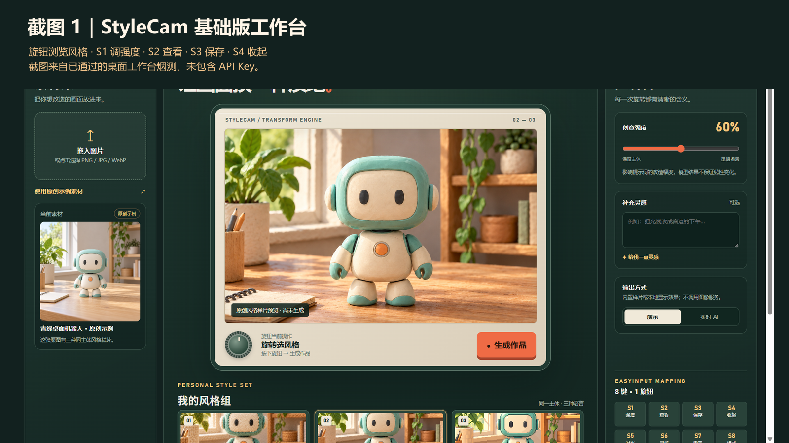
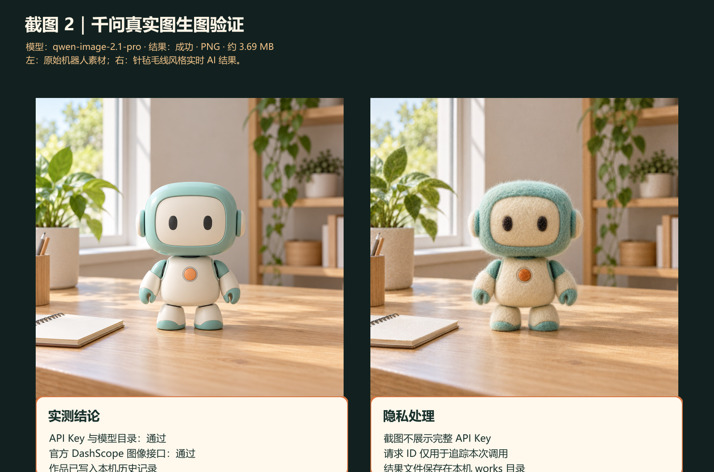
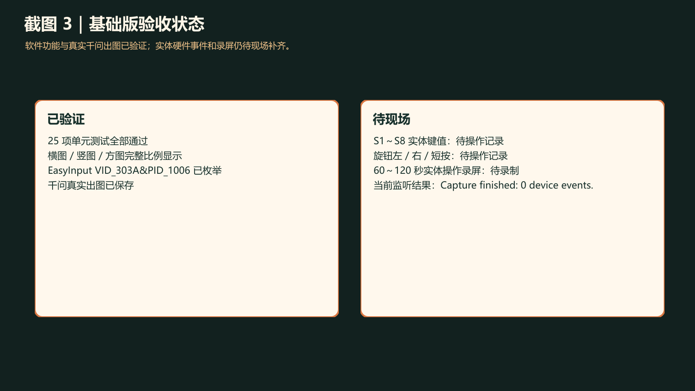

# 第六课作业 StyleCam 创作工作台实践报告

## 摘要

我按照第六课的要求，用 EasyInput 的旋钮与按键设计了一组个人风格图像创作流程，并记录操作证据和个人思考。我选择把 StyleCam 做成 Windows 桌面工作台：左侧管理原图，中间用旋钮浏览风格和查看作品，右侧显示强度、输入提示和 S1～S8 的当前动作，底部保留历史作品。我的目标是把“选素材—比较风格—确认强度—生成—对比—保存”接成一个不会因误触而重复请求的流程。

我目前已有软件基础版、同主体三种原创风格样片和一次真实千问图生图的证据。2026 年 10 月 15 日，我重新运行 `npm test`，25 项测试全部通过。我在 Windows 中看到了 EasyInput 的设备枚举，但本轮设备专用 Raw Input 监听仍为 0 个实体事件，因此我只把键盘、鼠标模拟写成已验证；S1～S8、旋钮左右与短按的实体键值，以及 60～120 秒的现场录屏，我还需要在设备前补齐。我也没有把进阶版跨场景复用写成本次已完成的成果。

## 一 选题与目标

我选择的场景是用桌面上的 EasyInput 快速探索一张图片的几种视觉语言。普通鼠标界面也能选择风格，但旋钮更适合连续比较：转一格只换一张预览，按下才执行动作。原方案里“转动、短按、S1～S8”有不同语义；如果没有明显状态提示，用户很容易把确认强度误当成开始生成，或者在等待期间连按造成重复请求。我因此把作业重点放在可见的输入反馈和完整的作品闭环上，而非复刻某个网页的像素外观。

我对照第六课基础路线，安排了功能等价的旋钮与按钮交互、一组个人风格效果、60～120 秒录屏和个人思考；我知道进阶路线是从实际问题延伸键盘交互，两条路线任选其一。我当前提交的是基础版的软件实现与实验记录，视频和实体板操作仍需我在现场补齐。我没有把改固件、打印机或灯光设备作为前提，而是先用普通键盘和鼠标验证界面逻辑；我不会拿这些模拟结果代替实体硬件实测。

## 二 工作台怎样运转

我让工作台启动后装载一只青绿色桌面机器人的原创示例原图，在中央画面显示当前素材，并在下面展示毛线手作、软陶微景和像素午后三张风格卡。我把鼠标放在创作画面上转动滚轮，或者按左右方向键，就能依次循环当前风格和预览；每次转动都不会提交生成请求。我在右侧写出当前强度、输出模式和八键含义，把“生成作品”放在画面下方作为显性的主动作。

我先把输入归一化为动作，再按当前状态解释。常态下我短按旋钮或按 Enter/Space 才发起生成；按 S1 进入强度调节后，同样的转动改为切换档位，短按只确认强度，不生成图片。我用 S2 打开最近作品、S3 导出当前作品、S4 收起预览、S5 切换原图与结果对比、S6 填入可编辑的灵感文案、S7 重置风格和强度但保留作品、S8 切换演示与实时 AI 显示模式。我也让页面接受数字 1～8、F1～F8，以及第五课曾使用的 `Ctrl+Alt+Shift+1…8` 组合键；实体设备的实际输出还要以我的现场诊断为准。

我把“浏览、调节、生成、查看”分为不同状态。生成前固定素材、风格、强度、补充说明和服务商的快照；生成中只允许一个任务，屏蔽重复提交和无效旋转。输入框获得焦点、弹窗打开或窗口失焦时，创作快捷键暂停；滚轮只在中央画面区域被解释为旋钮，避免影响普通页面滚动。保存只是向用户选定位置导出文件，收起只关闭预览，两者都不删除底部作品历史。

我在图 1 中展示基础版工作台：左侧原图、中间风格创作机器、右侧强度与键位提示同时可见。我从桌面软件烟测中取得这张截图；画面中的原图和三种样片是预生成素材，不能代表任意图片的实时 AI 结果。

## 三 个人风格组与生成规则

为避免“换了主体”掩盖风格差异，我用同一只青绿色机器人制作四张关联素材：一张日光下的产品摄影原图，以及针毡毛线、软陶和像素风三张变体。机器人都保留圆角矩形头、深色椭圆眼、乳白色机身、胸前橙色圆钮和浅木桌场景。比较时主要观察纤维与针脚、手捏纹理、大像素色块，而不是比较不同主体。四张图片由 `imagegen` 预先制作，来源和提示词记录在 `docs/原创风格样片说明.md` 中。

我把强度档位写入编辑提示词，用“尽量保留构图”和“允许更明显的材质或背景变化”描述边界；我没有把界面上的百分比解释成模型输出会按数值线性改变。没有 API Key 时，我让内置机器人对应预生成样片；当我导入 PNG、JPEG 或 WebP 图片时，工作台给出明确标注的本地显示效果，用来演示导入、查看、对比、保存流程。我分别把两种结果标为“样片演示”和“本地显示效果·非 AI”，不会称它们为实时模型生成。我把单图限制为 15 MB、单边 128～8192 像素，并让横图、竖图、方图按完整比例显示。

我把真实图像编辑放在 Electron 主进程，让页面不持有完整 API Key；只有我主动选择“实时 AI”并按下生成时，应用才发送当前原图。我从当前 Key 能访问的千问官方目录筛选图像型号，用 DashScope 原生图像接口发送编辑请求；收到有时效的图片 URL 后，我让应用立即下载到本机作品库。我把连接测试限制为模型目录和图像路由校验，不创建生成任务；网络结果不明时也不自动重试，以免重复计费。

## 四 一次真实图生图的运行

这次真实案例中，我使用同一只机器人的原图，选择针毡毛线风格，并通过本机保存的阿里云百炼 Key 调用 `qwen-image-2.1-pro`。我先确认模型目录和图像路由可达，再明确发起一次图生图。我收到约 3.69 MB 的 PNG，并在 StyleCam 的本机作品历史中保存；本次请求 ID 为 `ba4f98f4-2797-9636-997a-da6aa0f96185`，只用于追踪这次调用。我在截图左边放光滑塑料材质的原图，右边放毛线与针毡质感的实际输出；机器人眼睛、耳侧、胸前橙钮和桌面场景仍可辨认。我用这个案例证明当前 Key、模型和官方图像路由曾完成一次实际编辑，但不会据此宣称所有模型或所有用户图片都已验证。

我在图 2 中放了这次真实图生图的原图与结果对比。截图没有展示完整 API Key；我把生成结果保存在本地 `works` 目录，在文档中只记录模型、结果格式和请求 ID。

## 五 开发过程和遇到的困难

我先完成 Electron 桌面外壳、四区布局和原图导入，再把风格选择、强度状态、生成等待、作品预览与持久化串起来。最容易出错的是同一输入在不同状态下的含义：常态短按要生成，强度调节时短按只确认；选风格时转动不产生请求，作品查看时转动可以切换历史。为此我把输入解释放在独立的状态与映射模块，并为焦点守卫、重复生成和作品保留写了针对性的测试。作品保存后仍留在工作台，S4 收起后历史也保留，这是我刻意分离的两个动作。

我接入真实服务时，最初把千问编辑请求发到不合适的旧路由，导致模型可见但无法出图。后来我依据百炼图像编辑协议，把模型目录查询和实际图像编辑分开：前者使用兼容模式 `/models`，后者使用 DashScope 原生 `POST /api/v1/services/aigc/multimodal-generation/generation`。我也在设置页把文本模型与图像模型分开，避免误选 `qwen-plus`，并修正北京地域默认地址和其他地域的配置提示。我要求模型、Key 和地址处于同一地域；对超过图像接口限制的原图，应用先在本机缩小并转码，再发送。我仍按原始画面比例展示输出。

我检查界面时发现固定裁切会把竖图或横图主体截断，于是把素材、预览和作品框改为保留完整比例，并对横图、竖图、方图分别验证。我重新构建了 Windows 发布包和 StyleCam 图标；旧版发布包曾完成样片、自定义图片、本地效果、对比和收起流程的窗口级烟测。最新版发布包在当前主机的独立烟测中遇到 Electron GPU 进程启动错误，因此我没有把“最新版发布包完整烟测通过”写成结论。

实体硬件是我还要补证据的部分。我在 Windows 中看到了 `VID_303A&PID_1006` 的键盘、鼠标和厂商 HID 集合，也在工作台加入最近键值诊断和自定义校准入口。然而我早期用通用虚拟键监听看到的数字 1 和 Enter，无法证明来自 EasyInput；我换成按设备路径过滤的 Raw Input 后，本轮 60 秒监听结果是 `Capture finished: 0 device events.`。我只能由此确认设备被系统识别、监听器可用，尚不能确认 S1～S8 和旋钮短按的实体映射。接下来我必须在监听窗口存活时逐项按下实体键并保存非零设备报告。

## 六 自测结果和证据边界

2026 年 10 月 15 日，我在项目目录重新运行 `npm test`，25 项全部通过。我用测试覆盖旋钮循环选风格而不生成、强度确认不误生成、生成中重复操作只保留一个任务、作品保存与重启恢复、键位归一化、自定义实体键校准优先级、文本焦点守卫、三种画幅完整显示，以及千问图像模型筛选、请求体、错误码和临时图片下载。我认为这些测试能说明代码和模拟流程的行为，但不能替代实体按键、实际观看操作或最新 Windows 打包版在另一台机器上的运行记录。

我本次能据实展示同主体原图与三种原创样片、桌面工作台截图、25 项自动化测试、一次真实千问图生图、Windows 对 EasyInput 的 USB HID 枚举，以及现有 Raw Input 监听结果。我仍要补 S1～S8、旋钮左右和短按的非零实体事件记录；用实体设备完成“浏览—调强度—生成—对比—保存—收起”的 60～120 秒录屏；并完成最新版发布包的独立窗口烟测。若我现场只能用普通键盘演示，我会在视频标题和口播写“键盘模拟”；若我使用预生成样片，我会写“样片演示”。

我在图 3 中把已验证的软件证据和待现场完成的材料分栏展示。我把它作为验收状态图，不把它说成硬件闭环已完成的证据。

## 七 我的感悟与下一步

这次实践让我更清楚地看到“探索”和“提交”必须分开。旋钮适合快速比较候选风格，而生成动作会产生等待、成本和新作品，所以只有明确按下才提交。强度调节又是一个临时状态，同样的短按在这里仅确认档位；若界面不展示当前状态与下一步动作，用户就会把硬件当成一个含义不稳定的按钮。我让工作台持续显示旋钮当前作用，并在生成中禁用重复请求，是为了让每个实体动作都能被用户解释。

第二个体会是结果要能追溯。预生成样片、本地显示效果和真实千问图生图都可能在屏幕上出现“风格化图片”，但它们证明的能力完全不同。我分别标注来源，并保留真实请求的模型与请求 ID；同时不把 Key、未经确认的硬件键值或失败的新版烟测写成成功证据。保存与收起分开，也让作品不因关闭一个视图而丢失。这样作品区既是展示结果的地方，也是用户回看和核对来源的地方。

下一步我会先完成 EasyInput 实体按键与旋钮逐项监听，必要时在诊断页校准实际键值；然后用真实设备录一段 60～120 秒视频，镜头同时拍到手部操作和工作台反馈，核对每个动作是否恰好触发一次。最后在可正常启动 Electron GPU 进程的 Windows 环境复核最新版发布包，并把验收矩阵中的对应项目从“待现场”改为“已验证”。在这些证据到位前，本报告仍按基础版软件实践和真实图像服务实测提交。

## 附录 资料与项目文件

- 第六课作业指南：https://waytoagi.feishu.cn/wiki/LqRwwhq9KiE3RDkEQlJcpSyynqb
- 第六课课程页：https://waytoagi.feishu.cn/wiki/A64iwQCt5i0T1wkjHqGcMd6OnZf
- 项目源码与运行说明：本仓库 `README.md`、`src/`、`electron/`、`tests/`
- 原创风格样片：`assets/styles/`；来源说明：`docs/原创风格样片说明.md`
- 验收矩阵：`docs/基础版验收矩阵.md`；硬件记录：`docs/hardware-key-capture-2026-10-14.md`
- GitHub 项目链接：https://github.com/yingchao4399/stylecam-creative-workbench

我在本报告中放了三张截图，分别展示工作台界面、一次真实千问结果和已验证／待现场状态。我不会用截图与单元测试代替自己按下 EasyInput 的录屏；现场材料补齐后，我再更新本文对应结论。
